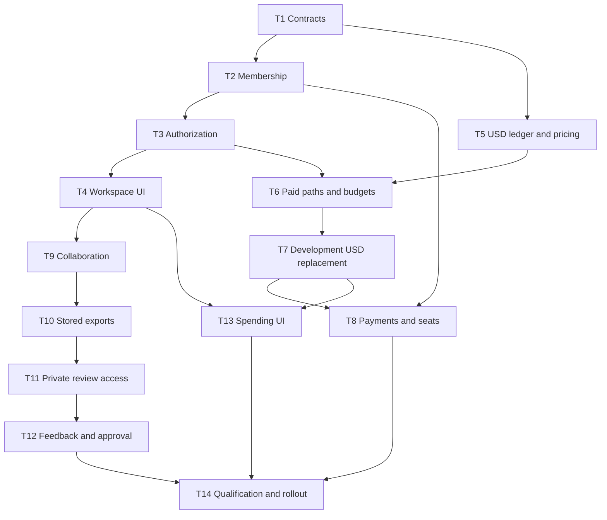

# Phase 1 implementation plan

> Pricing update — October 28, 2026: the current card uses supplier cost plus configurable 5% markup, including verified DeepSeek off-peak periods. This supersedes earlier 20% margin and fee-allocation decisions. See [generation pricing](generation-pricing.md) for settlement rules and remaining qualification. Earlier pricing notes below are historical; D2 remains nonblocking.

> Scope update (October 27, 2026): the current MVP is team collaboration, safe editing,
> stored video exports and simple private sharing. Comments, annotations, approvals,
> designated approvers and Reviewer-specific workflows below are deferred. Follow the
> [current implementation strategy](collaboration-sharing-implementation.md) for task
> status, dependencies and acceptance criteria. Polar is now selected and its disabled-by-default integration is implemented;
> see [activation and remaining qualification](polar-payments.md).

Status: Phase 1 is in progress. Completed local batches are listed below; unchecked
tasks and acceptance criteria remain pending.
Baseline: October 26, 2026. The first workspace-team/access batch is implemented
locally; remaining Phase 1 work is pending. Payment-provider work is deferred.

See [product roadmap](product-roadmap.md) for positioning, phase priorities, and
deferred scope.

## Latest payment batch

Polar checkout, signed durable webhooks, workspace subscriptions/seats, manual USD top-ups,
expiring $5 monthly funding pools and Owner billing controls are implemented behind environment
configuration. No account-level sandbox or live payment has been run. See
[setup, scope and remaining gates](polar-payments.md).

## Latest collaboration batch

- [x] Email verification and transactional invitation delivery via Nodemailer SMTP.
- [x] Timeline editing leases, read-only safeguards, audited takeover and version authorship.
- [x] Immutable stored exports, bounded uploads, download/delete controls and abandoned-upload cleanup.
- [x] Private video links with passwords, expiry, download controls and revocation.
- [x] Direct endpoint permission matrix, including removal of silent cross-workspace staff access.
- [x] Complete development two-account, rendered-video/audio and SMTP submission acceptance; see [results and remaining deployment checks](collaboration-acceptance-report.md).

See [implementation details and limits](collaboration-sharing-implementation.md) and the
[permission audit](collaboration-permissions-audit.md). Payments and review/approval
workflows remain deferred.

## Product implementation progress

Payment-provider onboarding and final retail rates are deferred at the user's request.
They do not block product work. The first implementation batch delivers:

- [x] Workspace member roles, verified-email in-app invitations, acceptance/revocation,
      role changes and removal, with audit records and invite rate limiting.
- [x] Creator project/series assignments and immediate removal of assignment access.
- [x] Settings team management, including project/series access controls.
- [x] Shared accessible projects/episodes in Projects and admin-accessible series lists.
- [x] Common production authorization plus internal script, timeline, entity, video
      admission and staging admission checks using current membership.
- [x] Admin-only spending-cap changes and guards against purging a team owner's data.
- [x] Backend authorization/lifecycle tests and Settings invitation/assignment UI tests.

The second product batch adds:

- [x] Global workspace selection, per-account persistence, production-link alignment,
      and workspace-keyed component/cache isolation.
- [x] Scoped project/template, series, asset, and transformation listing/creation paths.
- [x] Creator-owned transformation scopes and automatic assignment of duplicated projects.
- [x] Owner/Admin-only workspace balance/history and series creation controls.
- [x] Workspace renaming and confirmed ownership transfer to verified active members.
- [x] Account deletion handles all owned workspaces and preserves transferred workspaces.
- [x] Script/timeline/transformation drafts use account/workspace/project namespaces.
- [x] Polling for team access updates, ownership/scope tests, and late-response cache tests.

The third product batch adds the budget/reservation foundation:

- [x] Central atomic budget checks shared by video and analysis job admission.
- [x] Workspace UTC monthly and series/project lifetime caps, including held usage.
- [x] Separate settled spending and outstanding reservations in reports.
- [x] Series and UTC month snapshots on reservation; settlement/refund retain them.
- [x] Job/actor/scope validation, integer amounts, reserve/release replay guards.
- [x] Owner/Admin budget controls in Settings and assigned-project usage in Studio.
- [x] Tests for cross-project concurrency, month boundaries, moved episodes,
      authorization, input validation, refunds, and UI cap editing.

The fourth product batch replaces this intermediate credit foundation:

- [x] Integer micro-USD schema, dollar displays/inputs, USD development/staff funding.
- [x] Atomic account sequence and indexed workspace/month, series and project totals.
- [x] Ten-minute stored video quotes, accepted maxima, immutable job price snapshots.
- [x] Missing analysis/staging usage retains a reviewable hold instead of an assumed charge.
- [x] Internal ledger audit and sequence-guarded aggregate rebuild.
- [x] New precision, quote lifecycle, funding replay and reconciliation tests.

See [USD integration details](usd-accounting.md) for the provisional price card, exact
scope and remaining work. D1 final prices, verified provider costs, funding pools/expiry,
recurring allowances, session/member/date reporting and payment funding are still pending.
The old credit module/table has been replaced directly; no migration or dual ledger was
added. Fresh remote deployment and browser qualification have not been performed.

This is not completion of T2–T4. Still pending: emailed invitations, approved support
access, shared-library permission refinement, remaining role-aware UI, and the full
operation inventory. Invitations currently appear in Settings for the verified invited
email; no outbound email is sent. Reviewers cannot access production files until
published review functionality exists. Creator series assignments inherit episode
access, while series/library administration remains Owner/Admin-only. USD accounting uses a provisional development rate card. Payments stay deferred;
team management does not initiate development seat charges.

## Readiness checkpoint

See [pre-implementation assessment](phase-1-readiness.md). Supplier rate discovery
and repository baseline checks are complete; final rate configuration is still open.
Internal membership/RBAC and USD accounting may proceed using fixture prices. Live
Polar activation is blocked by product-policy compatibility (Genjutsu), account-level
seller verification, and unexecuted authenticated sandbox proofs. The likely jurisdiction
is Hong Kong (published payout coverage confirmed); the supplied organization name is
Dirrio. Final incorporation and sandbox/live account identities remain unverified.

## Objective and boundaries

Deliver one complete workflow: invite a collaborator, produce within a USD budget,
publish an immutable export, collect client feedback, obtain attributed approval,
and deliver the approved file.

Retain React, Bun/Elysia API/worker, Convex authentication/persistence, the current
project/series model, and browser rendering. Keep the product HTTP facade; do not
assume product queries already use live Convex subscriptions.

Development-only implementation: Dirrio is not in production. Replace old schemas,
credit paths, and fixtures directly. No production migration, legacy billing bridge,
backfill, dual write, or backward-compatible billing version is required. Development
fixtures may be regenerated during implementation; this document does not execute
or authorize an unattended reset of external resources. Creative document history
and published review versions remain product features, not legacy compatibility.

All T1–T14 tasks are P0 for the paid team MVP. Phase 0 acceptance work feeds T1 and
T14. No task estimates or dates are committed.

## Dependency graph

Payments and review implementation may proceed independently once their contracts
are stable. T7 replaces development billing directly. T14 qualifies the first production release;
there is no production cutover or legacy compatibility stage.

## T1 — Freeze product, permission, and commercial contracts

Dependencies: none. Blocks dependent schema/API contracts.

Tasks:

- [ ] Resolve the decision register below and record the selected policies.
- [ ] Map each protected operation to a named permission.
- [ ] Define scope inheritance, publishing rights, approver identity, seat lifecycle,
      pricing, rounding, quote expiry, budget periods, and payment failure behavior.
- [ ] Define supported browser/media/output acceptance fixtures and blocking editor gaps.

Acceptance criteria:

- [ ] Every protected operation has an explicit permission and resource scope.
- [ ] Every paid operation has a retail price and failure/settlement rule.
- [ ] Role changes have predictable access and seat consequences.
- [ ] Policies needed by each downstream task are settled before its implementation.

## T2 — Membership, invitations, and assignments

Dependencies: T1.

Current touchpoints: `packages/backend/convex/schema.ts`,
`packages/backend/convex/lib/workspaces.ts`, `packages/backend/convex/email.ts`,
`apps/api/src/services/email.ts`.

Proposed records: workspace memberships, invitations, project/series assignments.
Keep `ownerUserId` authoritative; do not create independently editable ownership.

Tasks:

- [ ] Add indexed memberships with fixed roles and lifecycle state.
- [ ] Add expiring, hashed, single-use invitation tokens bound to verified email.
- [ ] Implement invite, accept, revoke, remove, role change, and ownership transfer.
- [ ] Create owner memberships on workspace creation and regenerate development fixtures.
- [ ] Prevent orphaned workspaces and removal of the owner before transfer.
- [ ] Audit membership, assignment, and ownership changes.
- [ ] Reconcile membership activation with the billable-seat rules in T8.

Acceptance criteria:

- [ ] Repeated invitation acceptance yields one membership.
- [ ] Wrong-account, expired, and revoked invitations fail.
- [ ] Users can belong to multiple workspaces without duplicating production files.
- [ ] Fresh and regenerated workspaces give their owner the expected access.
- [ ] Removing membership prevents subsequent protected requests and new spending;
      authored work remains intact.

## T3 — Authorization and RBAC audit

Dependencies: T1–T2.

Current touchpoints: `packages/backend/convex/lib/access.ts`; independent ownership
checks in projects, assets, entities, generation, workspace, timeline versions,
series, Genjutsu, users, and staff operations; API service boundaries.

| Capability                           | Owner               | Admin               | Creator              | Reviewer                      |
| ------------------------------------ | ------------------- | ------------------- | -------------------- | ----------------------------- |
| Production visibility                | All                 | All                 | Assigned             | Published review content only |
| Edit/generate/export                 | Yes                 | Yes                 | Assigned             | No                            |
| Manage non-owner members/assignments | Yes                 | Yes                 | No                   | No                            |
| Subscription/payment management      | Yes                 | No                  | No                   | No                            |
| Financial visibility                 | All                 | All                 | Assigned productions | None                          |
| Set budgets                          | Yes                 | Yes                 | No                   | No                            |
| Publish/revoke review links          | Yes                 | Yes                 | Explicit grant       | No                            |
| Client approval                      | Designated approver | Designated approver | Designated approver  | Designated approver           |

Approval authority is separately granted and identity-verified. External review
sessions do not confer workspace membership or financial access.

Tasks:

- [ ] Separate read/edit/generate/publish/finance/admin permission checks.
- [ ] Replace owner-only and personal-workspace assumptions throughout public and
      internal operations; produce an operation-by-permission inventory.
- [ ] Apply series inheritance without exposing sibling episodes to episode-only users.
- [ ] Allow adopted episode resources without granting access to unrelated library media.
- [ ] Preserve production asset membership checks before input use or timeline saves.
- [ ] Audit media URL issuance, uploads, JSON storage, exports, notifications, and jobs.
- [ ] Define explicit audited staff support access; do not silently grant billing control.
- [ ] Separate member account deletion from team workspace deletion/purge.
- [ ] Recheck mutable permissions at financial admission, not only at initial API entry.

Acceptance criteria:

- [ ] Direct requests cannot bypass UI restrictions.
- [ ] Cross-workspace IDs and guessed media IDs fail safely.
- [ ] Episode-only access exposes no sibling production or unrelated library content.
- [ ] Reviewers cannot read scripts, inputs, source files, or finances.
- [ ] Removed users cannot initiate paid work, publish, or obtain new media credentials.
- [ ] Already-issued URL lifetimes are defined; downloaded files are not claimed revocable.
- [ ] Deleting a member account preserves shared workspace productions and history.

## T4 — Active workspace UI and cache isolation

Dependencies: T2–T3.

Current touchpoints: `apps/web/src/lib/api/client.ts`, `hooks.ts`, project/series/
assets/Genjutsu/settings features, and personal-workspace listing queries.

Tasks:

- [ ] Add switcher, workspace settings, invitations, role and assignment controls.
- [ ] Pass explicit workspace context to listing and financial operations.
- [ ] Scope query caches, local draft keys, and selected resources by workspace/project.
- [ ] Protect dirty edits during workspace switching and access loss.
- [ ] Refresh collaborator/access state using bounded polling or an explicitly chosen
      update mechanism; do not reset editor sessions on query refresh.

Acceptance criteria:

- [ ] Switching updates all lists, balances, and controls consistently.
- [ ] Other-workspace cached data never appears in the active workspace.
- [ ] Access loss displays clearly while retaining recoverable local work.
- [ ] Background updates do not overwrite dirty scripts or edits.

## T5 — Monetary ledger and versioned retail quotes

Dependencies: T1.

Current touchpoints: `packages/backend/convex/billing.ts`, `schema.ts`,
`packages/shared/src/adapters.ts`, API/backend adapter cost helpers.

Proposed records: USD funding/adjustment ledger, usage authorizations and holds,
settlements/releases, funding provenance, versioned price schedule, payment events.
Final table boundaries are an implementation decision; accounting invariants are fixed.

Tasks:

- [ ] Use safe integer micro-USD; validate arithmetic bounds and define display rounding.
- [ ] Distinguish purchased/promotional funding, usage, hold releases, usage refunds,
      payment refunds, and administrative adjustments.
- [ ] Add stable idempotency keys and deterministic account sequence/version ordering.
- [ ] Add server-generated expiring quotes with price version, units, and maximum charge.
- [ ] Snapshot workspace, actor, project, series-at-purchase, session, and budget period.
- [ ] Track provider cost separately from customer retail charges.
- [x] Define aggregate rebuild/reconciliation from authoritative accounting records.

Acceptance criteria:

- [ ] Duplicate events cannot double-fund, double-charge, or double-release.
- [ ] Funding, available balance, outstanding holds, charges, and refunds reconcile.
- [ ] Accepted authorizations retain their price after a price update.
- [ ] The client cannot supply or alter authoritative prices.
- [ ] No monetary result depends on floating-point currency arithmetic.

## T6 — Convert all paid paths and enforce budgets atomically

Dependencies: T3, T5.

Current touchpoints: `generation.ts`, `textJobs.ts`, `workspace.ts`, `staging.ts`,
`genjutsu.ts`, `apps/api/src/services/generation.ts`, `staging.ts`, `transforms.ts`,
and shared transformation analysis pricing.

Tasks:

- [ ] Inventory every enabled paid operation, including video, extension, analysis,
      staging, Genjutsu analysis/rendering, and any enabled upscale path.
- [ ] Replace credit estimates/settlements with versioned retail USD prices.
- [ ] Atomically validate permission, quote, funds, budgets, reservation, job creation,
      and dispatch intent before any paid provider request.
- [x] Add workspace monthly, series lifetime, and project/episode lifetime caps.
- [x] Account for outstanding reservations in all applicable caps.
- [ ] Report Genjutsu by session; initially enforce its workspace cap.
- [x] Update indexed financial aggregates transactionally; avoid full-ledger cap scans.
- [x] Keep historical series attribution when projects move; avoid double-counting reuse.
- [x] Pin workspace budget period at authorization, including jobs crossing month-end.
- [ ] Preserve replay detection and uncertain-submission holds; never blindly retry paid POSTs.
- [ ] Handle multi-stage operations with separate analysis/rendering financial outcomes.
- [ ] Allow workers to settle authorized work after initiator removal; reauthorize any
      genuinely new paid stage according to the selected cancellation policy.

Acceptance criteria:

- [ ] Concurrent jobs cannot exceed balance or any applicable cap.
- [ ] Reservation-to-settlement transitions count spending once.
- [ ] Settlement cannot exceed authorized maximum; unused funds release once.
- [ ] Failed rendering does not incorrectly refund successful billable analysis.
- [ ] Worker retries, repeated callbacks, cancellation, and uncertain submissions reconcile.
- [ ] Later membership/series changes do not rewrite historical financial attribution.
- [ ] A lower budget than existing obligations blocks new work without erasing obligations.

## T7 — Replace development credits with USD

Dependencies: T5–T6. D1 retail rates block final price configuration; D2 does not
block implementation because no production credit balances need preservation.

Tasks:

- [x] Remove credit-based fields, pricing helpers, endpoints, UI labels, staff grants,
      starter grants, and fixtures superseded by USD accounting.
- [x] Update enabled video, staging, analysis, and Genjutsu paths to the single USD model.
- [ ] Regenerate development fixtures with monetary funding, holds, budgets, and memberships.
- [ ] Ensure development workers use the new model and cannot replay obsolete fixture jobs.
- [x] Update generated bindings, API manifests, documentation, and accounting tests.
- [ ] Retain D2 as a deferred record only; do not build conversion tools, dual ledgers,
      legacy job bridges, billing-version compatibility, or production migration scripts.

Acceptance criteria:

- [ ] Fresh setup and regenerated development fixtures operate entirely in USD.
- [x] No enabled customer/staff flow relies on credit units or legacy billing records.
- [ ] All new USD jobs reconcile after retries, cancellation, and failure.
- [ ] No production migration or legacy preservation is required for launch.

## T8 — Subscription, creator seats, and manual top-ups

Dependencies: T2, T5–T7. Implement and qualify in the Polar sandbox before launch.

The base integration is implemented with payments disabled; [Polar setup](polar-payments.md)
records its exact scope, automated coverage and remaining live qualification. Unchecked
acceptance criteria below still require actual Polar sandbox validation.

Tasks:

- [x] Select Polar as the launch payment provider.
- [ ] Resolve Polar product-policy compatibility for Genjutsu and verify seller eligibility.
- [x] Add workspace customer/subscription mappings after sandbox access is available.
- [x] Use the TypeScript SDK directly; do not adopt the deprecated Elysia adapter.
- [x] Add verified, replay-safe webhook ingestion and a durable event-processing log.
- [x] Implement owner billing management, subscription, creator quantities, and top-ups.
- [x] Fund USD only from authoritative successful payment events.
- [x] Grant $5 included workspace usage once per successfully paid subscription period;
      expire at period end, with no rollover or grant on seat changes/webhook retries.
- [x] Bill active Owner/Admin/Creator memberships; include owner in base plan;
      Reviewers are free and pending invitations do not independently start billing.
- [x] Require owner authorization for increased billable seats, even for Admin invitations.
- [x] Define pending seat activation so payment/provider failure cannot grant unintended
      paid entitlements or cause duplicate membership changes.
- [ ] Implement selected proration, cancellation, grace, refund, and dispute policies.
- [ ] Reconcile processor funds/subscriptions with application balances and memberships.

Acceptance criteria:

- [ ] Duplicate/out-of-order events cannot duplicate funds or corrupt seat quantities.
- [ ] Failed top-ups produce no spendable balance.
- [ ] Delayed confirmations display processing rather than fabricated funds.
- [ ] Paid role promotions disclose their billing effect and require owner authorization.
- [ ] Non-owners cannot alter payment methods or subscription terms.
- [ ] Payment problems preserve selected read/review access while blocking new unauthorized usage.

## T9 — Safe editing and shared revision visibility

Dependencies: T3–T4.

Current touchpoints: backend/API timeline version services, workspace script saves,
`apps/web/src/features/edit/EditPage.tsx`, timeline history, and studio script editors.

Tasks:

- [ ] Add expiring project timeline leases, heartbeat, handoff, and fencing generation.
- [ ] Validate active lease on saves in addition to expected-parent version checks.
- [ ] Add Admin takeover with warning and audit event.
- [ ] Show editor identity, authorship, version labels, save state, and conflict state.
- [ ] Preserve script conflict recovery and refresh shared changes safely.
- [ ] Restore old versions by appending, not overwriting history.

Acceptance criteria:

- [ ] Two clients cannot save concurrently as the active editor.
- [ ] An expired/displaced editor cannot overwrite the new holder's work.
- [ ] Takeover preserves a recoverable local draft.
- [ ] Restoration retains previous versions and referenced media.
- [ ] Background refresh does not reset unsaved edits.

## T10 — Stored immutable published exports

Dependencies: T3, T9.

Current touchpoints: `apps/web/src/features/edit/ExportDialog.tsx`, export engine,
`packages/backend/convex/exports.ts`, storage/media retention.
Current exports download locally and record metadata; stored review media is new.

Tasks:

- [ ] Require a saved timeline snapshot for publication and export that exact snapshot.
- [ ] Add upload/validation/finalization states and retry-safe publication IDs.
- [ ] Store file, timeline version, author, dimensions, duration, size, integrity metadata.
- [ ] Finalize only after successful upload and authoritative validation.
- [ ] Protect published files from ordinary cleanup; define orphaned-upload cleanup.
- [ ] Keep local download available when publishing fails.
- [ ] Enforce storage allowance, upload limits, and existing five-minute/1080p envelope.

Acceptance criteria:

- [ ] Published video plays without the creator's browser remaining open.
- [ ] Later edits never modify the published bytes.
- [ ] Interrupted uploads expose no partial review version.
- [ ] Publication retry creates one published version.
- [ ] Playback metadata matches the stored file and selected timeline snapshot.

## T11 — Private review sessions and media delivery

Dependencies: T3, T10.

Current touchpoints: API app/routes, storage service, web routing. The existing
product operation facade requires an authenticated bearer token; external review
needs a dedicated, narrowly scoped access path.

Tasks:

- [ ] Add high-entropy hashed link tokens, optional password, expiry, and revocation.
- [ ] Exchange access credentials for short-lived scoped review sessions.
- [ ] Define which published versions each link can view; no implicit source access.
- [ ] Authorize playback/range delivery without exposing permanent storage URLs.
- [ ] Separate watch, comment, download, and approve grants.
- [ ] Rate-limit credential attempts and writes; avoid tokens in logs/referrers/analytics.
- [ ] Define password-change/session invalidation and access revocation behavior.

Acceptance criteria:

- [ ] A review session cannot obtain unrelated exports or production data.
- [ ] Expired/revoked links and sessions fail on subsequent media requests.
- [ ] Seeking/range playback works with the protected delivery path.
- [ ] Download permission controls delivery UI/API; do not promise copy protection.
- [ ] Buffered or downloaded bytes are explicitly outside revocation guarantees.

## T12 — Feedback, approval, and approved delivery

Dependencies: T11.

Current foundation: project `notes` records are plain text; versioned, timestamped
review discussions and approval events are new.

Tasks:

- [ ] Add version-bound threads/replies, timestamps, resolution, and reviewer identity.
- [ ] Validate timestamps against published media duration.
- [ ] Verify designated approvers by email or authenticated account.
- [ ] Record immutable approve/request-changes events against exact published versions.
- [ ] Implement one verified designated approver per review; defer quorum configuration.
- [ ] New versions begin unapproved; preserve prior approvals historically.
- [ ] Add review notifications and direct links without leaking private credentials.
- [ ] Deliver the exact approved file when download is authorized.

Acceptance criteria:

- [ ] Version 1 comments never silently move to version 2.
- [ ] Forwarded watch links do not confer approval identity/authority.
- [ ] Duplicate decisions create one event; concurrency cannot approve the wrong file.
- [ ] Revoked sessions cannot submit feedback or approval.
- [ ] The delivered file is the approved published artifact.

## T13 — Spending UI and reporting

Dependencies: T4, T6–T7.

Tasks:

- [ ] Workspace view: funding, available balance, reserved, spent, monthly cap.
- [ ] Project/episode budget panel, series rollup, Genjutsu session reporting.
- [ ] Filters by member, operation, production, and date; paginate activity.
- [ ] Job details show quote, hold, settlement, release/refund, and price version.
- [ ] Explain period semantics for incurred work versus later adjustments.
- [ ] Keep subscription/seat fees separate from attributed production usage.
- [ ] Use indexed aggregates with reconciliation/rebuild support.

Acceptance criteria:

- [x] Spent means settled net usage; reserved means outstanding holds.
- [x] Available budget subtracts both spent and reserved.
- [ ] Series totals reconcile to attributable episodes plus direct series usage.
- [ ] Shared asset reuse does not replicate its original charge.
- [ ] Financial visibility respects role and production scope.
- [ ] Submission, settlement, and refunds update visible totals clearly.

## T14 — Qualification and staged rollout

Dependencies: all tasks; qualifies the first production launch.

Tasks:

- [ ] Extend access, credit/accounting, production-safety, series, boundary, save,
      and export suites with meaningful new invariants.
- [ ] Test role × operation × resource scope, including direct/backend paths.
- [ ] Test concurrent holds, month boundaries, refunds, duplicate/out-of-order events.
- [ ] Verify fresh USD setup, regenerated fixtures, pending/uncertain jobs, and late events.
- [ ] Run payment sandbox lifecycle and reconciliation scenarios.
- [ ] Test two real browser sessions for editing, handoff, access removal, and recovery.
- [ ] Visually/audibly verify exported timing, titles, framing, and audio in review playback.
- [ ] Run repository typecheck, lint, tests, build, and formatting checks.
- [ ] Document observability and response for failed webhooks, stranded holds,
      export failures, access failures, and reconciliation differences.
- [ ] Qualify in development and sandbox, then launch with pilot teams before wider paid onboarding.

Release acceptance:

- [ ] Authorization inventory has no unreviewed protected operations.
- [ ] Ledger/payment totals have zero unexplained differences.
- [ ] No paid network calls are required for automated tests; live tests have explicit caps.
- [ ] Owner funds workspace → invites Creator → assigns episode → sets budgets →
      Creator generates/edits → publishes v1 → client requests changes → publishes v2 →
      verified approver approves → client downloads that exact approved file.
- [ ] Operator recovery runbook is reviewable before first production launch.

## Decision register and accepted policies

Accepted by the user, with a development-only scope and a 20% API margin target.
Implementation tasks remain pending. The $5 monthly allowance and Polar selection
are accepted; exact retail rates and provider qualification remain open.

| ID  | Status                              | Selected policy / remaining work                                                                                                                                                                                                      |
| --- | ----------------------------------- | ------------------------------------------------------------------------------------------------------------------------------------------------------------------------------------------------------------------------------------- |
| D1  | Policy accepted; rate card pending  | USD, integer micro-USD, 10-minute quotes, locked maximum, 20% API contribution margin; complete provider and payment-cost checks before setting retail rates.                                                                         |
| D2  | Deferred, nonblocking               | Credit conversion remains pending cost/balance checks as a historical decision item. No conversion is required or implemented for this development-only launch.                                                                       |
| D3  | Accepted; legacy clauses superseded | Purchased funds do not expire; new starter promotions expire after 90 days; promotional funds first, earliest expiry first. No migrated legacy allowance.                                                                             |
| D4  | Accepted                            | $29/month workspace with owner seat; $15/month extra Creator/Admin; free Reviewers; 25 GB pooled storage; 100 GB monthly delivery; $10 manual minimum top-up. $5 monthly included workspace usage, no rollover or per-seat allowance. |
| D5  | Accepted                            | Owner controls payments; Admin controls budgets and non-owner access; Creators operate on assigned work and need Manage reviews to publish.                                                                                           |
| D6  | Accepted                            | UTC calendar-month workspace cap; lifetime series/project caps; financial attribution pinned at authorization.                                                                                                                        |
| D7  | Accepted                            | One verified designated approver per review, exact version approval, no MVP quorum settings.                                                                                                                                          |
| D8  | Accepted                            | Explicit published versions; 30-day link default, 7/30/90-day choices; 24-hour sessions, 5-minute playback credentials, revocation checks; 90-day post-cancellation recovery.                                                         |
| D9  | Accepted; qualification pending     | Polar selected for launch; verify eligibility and sandbox flow compatibility. 7-day renewal grace, paid increases, decreases at renewal, period-end cancellation.                                                                     |
| D10 | Accepted                            | Bounded polling, 60-second fenced lease with 15-second heartbeat, conservative paid-stage cancellation, time-limited audited support.                                                                                                 |

### D1 — Retail pricing and financial semantics

- Target **20% API contribution margin**, with subscriptions the primary profit source.
- Measure API revenue net of sales tax against attributable API/analysis variable costs
  and allocated collection fees. Track platform storage/delivery against subscription
  economics; do not count the same cost twice.
- Before collection fees, price = cost / 0.80: $1.00 cost implies $1.25 retail.
  With allocated percentage fee f and fixed cost a, price = (cost + a) / (0.80 - f).
  Allocate funding transaction fees across the funded usage; do not charge a processor
  fixed fee for every generation. Provider selection and top-up size affect the rate card.
- Quotes expire after 10 minutes and accepted quotes retain their price. Reserve the
  maximum, settle authorized actual usage, and release unused funds.
- Dirrio absorbs unauthorized overruns. Failed generation releases its generation
  charge; successful analysis remains billable if a later rendering stage fails.
- Poor creative results alone do not cause automatic refunds. Technical failures do.
- Display cents; describe sub-cent charges as less than $0.01 with exact detail available.
- [x] Read current published and authenticated Sume rate definitions and current DeepSeek prices.
- [ ] Resolve Remix billable-second ambiguity and confirm operation-specific pricing.
- [ ] Verify full supplier rates by operation/resolution/duration, payment fees, and
      representative costs; configure a published rate card meeting the 20% target.

### D2–D3 — Funding and development replacement

- No production customers or balances require conversion. Replace the development
  credit system directly and regenerate fixtures. D2 is not a launch dependency.
- Purchased funds do not expire. New starter promotional allowance expires after
  90 days; its amount still needs pricing/abuse-cost validation before launch.
- Consume eligible promotional funds first, earliest expiry first, then purchased funds.
  Allocate sources when reserving and retain that allocation through settlement.
- Refunds restore the original funding source. Promotional funds expiring while held
  receive 30 days after release. Payment refunds remove the corresponding unused funds
  and return money to the original payment method.
- Offer unused purchased top-up refunds on request during pilot, subject to provider
  processing and published eligibility rules. Promotional funds have no cash redemption.
- Recurring included usage expires at the paid subscription period
  end, does not roll over, and is granted only once per successfully paid period.

### D4 — Subscription value and included usage

The accepted pilot package funds editing, production workflow, collaboration, review,
versioning, and stated storage/delivery allowances. Additional creator seats add people,
not storage or usage automatically. Warn before allowance exhaustion; block incremental
uploads/publication/delivery as appropriate, never silently delete or charge overages.
Keep local download/recovery options available. Annual plans and auto-top-up are deferred.

**Accepted:** include $5 retail USD usage per paid workspace
month within the $29 price; no additional allowance per seat. This removes the immediate
need for a second purchase while keeping subscriptions the primary profit source.
At a 20% API margin, full redemption represents approximately $4 of attributable cost,
subject to the final rate card, before other subscription costs. It is not $5 cash.
Grant after confirmed initial/renewal payment, expire at period end, and do not grant
again for seat changes, retries, or duplicate webhooks. First paid period receives the
full allowance; no rollover. Warn as it runs out and require prepaid top-ups afterward.

- [x] User selected the $5 monthly workspace allowance.
- [ ] Validate 25 GB/100 GB pilot economics and define a manual upgrade path.

### D5 — Roles and production creation

- Owner: all production, billing, ownership, and workspace deletion rights.
- Admin: all productions, non-owner memberships/assignments, reporting, and budgets;
  no payment/subscription changes. Paid capacity increases require Owner approval.
- Creator: edit, generate, export, and view financials for assigned productions.
  Manage reviews is an explicit project/series grant for publishing/revoking links.
- Creators may create standalone projects and are assigned automatically. Series and
  episode creation initially require Owner/Admin authority.
- Series access inherits to episodes; episode-only access does not reveal siblings.
- Reviewers see shared published content only and are free.
- Approval authority is separately verified; workspace roles cannot impersonate clients.

### D6 — Budget timing and reporting

- UTC calendar months, displayed locally; clearly separate from subscription renewal.
- Pin usage and holds to authorization month. Later settlements adjust that month;
  refunds also appear in current activity. Outstanding holds survive the boundary.
- Series/project caps are lifetime. Subscription/seat fees do not consume usage budgets.
- Lowering caps below obligations blocks new jobs without erasing committed work.

### D7–D8 — Review, approval, links, and retention

- One verified designated approver; email verification or authenticated identity.
  Named commenters may be unverified but must be labelled accordingly.
- Approval/request-changes events bind immutable published versions; revisions start
  unapproved. Changing approvers preserves prior decisions.
- Links show explicitly added published versions only; default expiry 30 days, options
  7/30/90. Password optional. Sessions 24 hours; playback credentials 5 minutes.
  Check link/session revocation on subsequent delivery requests; password change ends
  existing sessions. Download disabled by default, explicitly enabled for delivery.
- Active paid workspaces retain published artifacts until explicit deletion within
  allowances. Link revocation does not delete media, comments, or approvals.
- After subscription ends, provide 90 days read/download recovery, then delete media
  after notices. Warn before deleting published artifacts. Final lightweight audit
  retention schedule and notification timing must be documented before launch.
- Retention applies to media; non-expiring purchased funding is tracked separately.
  Before deleting the last workspace records, resolve remaining purchased funds through
  the refund/account-closure policy rather than silently forfeiting them.

### D9 — Payments and lifecycle

The provider comparison is in [the roadmap](product-roadmap.md#payment-provider-comparison).
Polar is selected for first launch, subject to seller eligibility,
product acceptance, and a sandbox proof of the exact seat/payment policies. Do not
implement both providers or build a speculative provider framework.

- Monthly subscriptions only; manual top-ups; hosted checkout/management.
- Owner approves paid increases; charge proration immediately and activate new capacity
  only after authoritative payment success. A browser success redirect is insufficient.
- Remove member access immediately; lower billed capacity at next renewal. Already-paid
  capacity can be reassigned until then. Schedule rather than immediately applying a
  provider quantity reduction if that would issue an unwanted prorated credit.
- Cancel at period end. Failed renewal gets 7 days grace for existing seats and prepaid
  generation; no increased capacity or unpaid included allowance.
- After grace, retain read/review/download access within the recovery window. Failed
  top-ups never fund balances; disputed funds are quarantined and usage may be paused.
- Dirrio owns the authoritative USD ledger, holds, budgets, and RBAC for either provider.
  Payment-side credits/meters must not produce a second charge or competing balance.
- [x] Select Polar for launch.
- [ ] Confirm operating-entity eligibility and prepaid usage acceptance with Polar.
- [ ] Resolve acceptable-use restrictions affecting Genjutsu before live checkout;
      provider selection is accepted but product approval is not established.
- [ ] Prove workspace-level billing, $29 base + $15 seats, failure-safe upgrades, scheduled
      decreases, refunds, top-ups, and webhook replay/out-of-order behavior in sandbox.

### D10 — Updates, editing leases, cancellation, and support

- Poll active collaboration/review state every 10 seconds; job status every 3 seconds
  with backoff. Pause frequent polling in inactive tabs and refresh on focus.
- Timeline lease: 60 seconds, heartbeat every 15 seconds, fenced save plus expected-parent
  check. Explicit handoff; Owner/Admin takeover warns and records an audit event.
- Cancel before provider submission and release unused funds. After submission, explain
  that cancellation may not prevent the charge. Prevent unsubmitted stages; retain
  successful analysis charges. Removing a member stops new paid stages while existing
  submitted work continues financial reconciliation.
- No routine unrestricted staff access. Owner/Admin grants 24-hour, reason-bound audited
  support access excluding generation, payments, and client approval. Emergency access
  requires a recorded reason and audit event.

### Remaining planning work

- [ ] Complete D1 rate-card checks; retain D2 as deferred/nonblocking, not engineering scope.
- [x] Select $5 included monthly workspace usage and Polar for launch.
- [ ] Finalize launch notices, refund eligibility, starter grant amount, audit retention,
      and storage/delivery economics before customer-facing terms are published.
- [ ] Assign implementation owners and estimates; keep Phase 2 out unless acceptance blocks launch.
